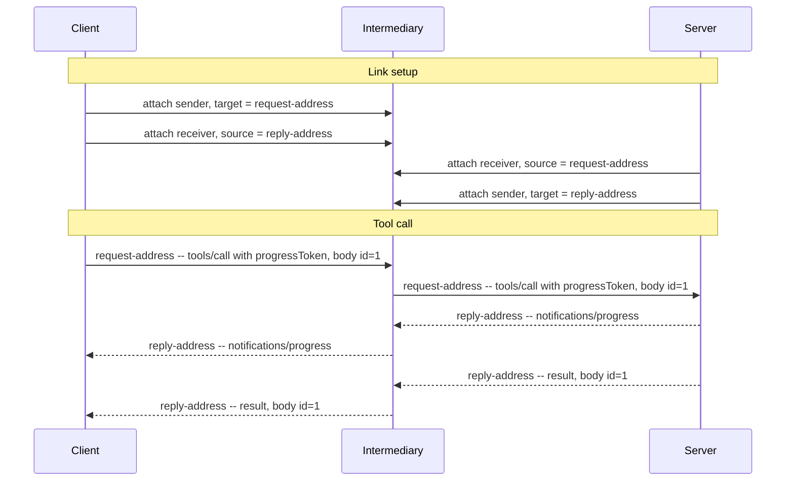

# MCP over AMQP 1.0 -- Binding Specification

## Working Draft

> **Status of this document.** This is a working draft that is not for publication or
> implementation.
>
> **Revision.** 2026-09-24. Working Draft numbering is reserved for drafts submitted for public
> review.

## 1  Introduction

The Model Context Protocol (MCP) is an open protocol for connecting LLM applications to external
tools and data sources. As of version 2026-07-28 it uses JSON-RPC 2.0 [JSON-RPC] and is stateless.
MCP currently defines two transports: stdio and Streamable HTTP.

This binding specification defines a binding of MCP onto AMQP 1.0 [AMQP-v1.0]. It defines the
application endpoints so MCP implementations can use any conforming AMQP 1.0 broker or router as a
transport without modification.

A separate binding specification for JSON-RPC 2.0 on AMQP 1.0 [JSONRPC-AMQP] defines the framing of
a JSON-RPC message on AMQP and the correlation of a response with its request. This binding
specification applies that binding and defines only what MCP adds to it.

MCP's transports today define a direct, Client-initiated connection. Over AMQP, MCP Clients and
Servers can use the brokered and routed topologies that production messaging deployments already
use, including paths that cross network boundaries and paths on which many Clients share one
connection. Any Server instance can serve any request, so a node with competing consumers behind a
single address is an ordinary MCP deployment.

This binding specification does not address flow control and link credit, settlement policy,
addressing conventions, error taxonomy, and security beyond the SASL and TLS mechanisms AMQP already
defines.

### 1.1  Normative References

- **[AMQP-v1.0]** *OASIS Advanced Message Queuing Protocol (AMQP) Version 1.0*. OASIS Standard, 29
  October 2012.
- **[MCP]** *Model Context Protocol Specification*, version 2026-07-28.
  https://modelcontextprotocol.io
- **[JSON-RPC]** *JSON-RPC 2.0 Specification*. https://www.jsonrpc.org/specification
- **[JSONRPC-AMQP]** *JSON-RPC 2.0 over AMQP 1.0 -- Binding Specification Version 1.0*. Committee
  Specification NN, DD Month YYYY.
  https://docs.oasis-open.org/amqp/jsonrpc-amqp/v1.0/csNN/jsonrpc-amqp-v1.0-csNN.html

## 2  Definitions

This binding specification uses the terms defined in [JSONRPC-AMQP].

- **Client** -- The Client sends JSON-RPC requests and notifications, as defined by [MCP]. It is the
  Requester of [JSONRPC-AMQP].
- **Server** -- The Server answers each request with a JSON-RPC response (a result or an error),
  optionally preceded by notifications scoped to that request, as defined by [MCP]. It is the
  Responder of [JSONRPC-AMQP].

## 3  Overview

Every MCP interaction begins with the Client [MCP]: the Client sends requests and notifications, and
the Server answers each request with a response, optionally preceded by notifications scoped to that
request. A Client uses two links: a Request Link for sending requests and notifications, and a Reply
Link for receiving responses and notifications. A Server uses the inverse links: a Request Link for
receiving requests and notifications, and a Reply Link for sending responses and notifications.

The body of each JSON-RPC message is an MCP message defined by [MCP]. This binding specification
does not add fields or modify its contents. [JSONRPC-AMQP] defines the framing of JSON-RPC messages
on AMQP.

This binding specification applies only to MCP version 2026-07-28.

## 4  MCP Message Exchange

[MCP] defines three patterns of requests, responses, and notifications: request and response, multi
round-trip requests, and subscribe and notify. In each, the Server may send more than one message in
response to a request, and it sends each of them to the request's Reply Address with the request's
`message-id` as its `correlation-id` [JSONRPC-AMQP].

### 4.1  Request and Response

The Client sends a request with the AMQP properties defined by [JSONRPC-AMQP], including
`message-id` and `reply-to`. Before the Server sends the response, it may send notifications such as
progress notifications. The Server sends the notifications and the response with the same
`correlation-id`.

### 4.2  Multi Round-Trip Requests

When a Server needs Client input to complete a request, it sends a response to the Reply Address
with an `InputRequiredResult`, and the Client retries by sending the original `params` together with
`inputResponses` [MCP]. The retry is a new JSON-RPC request that is not correlated with the original
request. It has a new `id`, so the Client sends it with a new `message-id` [JSONRPC-AMQP]. If
multiple Server instances serve the Request Address, any instance can serve the retry, since the
retry contains the original `params`, any `inputResponses`, and the `requestState` the Server
returned [MCP].

### 4.3  Subscribe and Notify

When a Client sends a `subscriptions/listen` request, the Server responds with a long-lived stream
of notifications [MCP]. The Server sends every notification on the stream to the same Reply Address
with the same `correlation-id`, and retains the request's `message-id` and `reply-to` for as long as
the stream stays open [JSONRPC-AMQP].

## 5  Link Topology

A Client sends messages to a Request Address and receives messages on its Reply Address. Many
Clients may share a node backing the Request Address, and many Server instances may serve it: using
the per-request correlation [JSONRPC-AMQP] defines, a Server returns each response to the Client
that issued the request, and the intermediary does not keep any shared state.

## 6  Cancellation

Unlike stdio and Streamable HTTP, AMQP does not define a connection failure as cancelling a
request, so a Client limits how long it waits for the response to each request [JSONRPC-AMQP]. Once
that time has elapsed, a Client MUST cancel the request by sending `notifications/cancelled`, with
`requestId` set to the request's `id` [MCP].

A Server MUST limit how long it keeps a subscription stream open. Once that time has elapsed, it
MUST end the stream, and SHOULD do so by sending the response to the `subscriptions/listen` request,
a result with `resultType` set to `complete`, to the request's Reply Address.

## 7  Ordering

[MCP] requires a Server to send `notifications/subscriptions/acknowledged` as the first message on a
`subscriptions/listen` stream, and not to send any notification on the stream before it. An AMQP
receiver on a link receives messages in the order the sender sent them, so a Server MUST send all of
its messages for a request on one Reply Link, in the order [MCP] requires. An intermediary may still
deliver them to the Client in a different order [JSONRPC-AMQP].

## 8  Authorization

This binding specification uses the SASL and TLS mechanisms defined by [AMQP-v1.0].

## Appendix A  Example Exchange (Informative)

The following example shows link setup, one tool call, a progress notification, and a result
through an intermediary.

The intermediary relays each transfer without modifying the JSON-RPC message.

## Appendix B  Revision History (Informative)

Newest first. One line per revision; the commit messages for this file contain the detail.

| Date | Change |
|------|--------|
| 2026-09-24 | Describe the [MCP] message patterns; add Cancellation, Ordering and Authorization; map Client and Server to the [JSONRPC-AMQP] roles; remove the Conformance section. |
| 2026-09-17 | Correct statements about [MCP]: drop a MUST-level closing result [MCP] makes a SHOULD; leave transport termination to [JSONRPC-AMQP]; ground the two-link model on [MCP]. |
| 2026-09-01 | Cite [JSONRPC-AMQP] as a normative reference and use its citation anchor throughout. |
| 2026-08-24 | Layer on the JSON-RPC 2.0 over AMQP 1.0 binding, removing the framing and correlation defined here; drop the end-to-end ordering claim for subscription streams. |
| 2026-08-08 | Track [MCP] 2026-07-28, which makes MCP stateless, and simplify the request/response mechanism to a contract stated in message `properties`. |
| 2026-07-28 | First draft submitted to the Technical Committee for discussion. |
